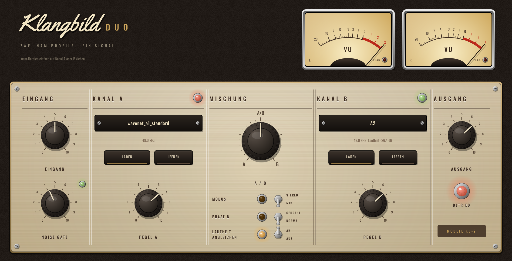

# Klangbild Duo

Zwei **NAM-Profile** (Neural Amp Modeler) gleichzeitig spielen und mischen – z. B. Clean + Crunch,
Marshall + Fender oder zwei Mikrofonpositionen. Audio Unit für Logic Pro (außerdem VST3 und Standalone),
gebaut mit [JUCE](https://juce.com) und dem offiziellen [NeuralAmpModelerCore](https://github.com/sdatkinson/NeuralAmpModelerCore).



## Funktionen

| Bereich | Regler | Was passiert |
|---|---|---|
| **Eingang** | Eingang, Noise Gate | Pegel vor beiden Modellen; Gate erkennt am trockenen Eingang und wirkt hinter den Modellen (grüne Lampe = offen) |
| **Kanal A / B** | Laden, Leeren, Pegel | je ein `.nam`-Profil; Lampe leuchtet, wenn geladen. Dateien lassen sich auch einfach auf die linke/rechte Hälfte ziehen |
| **Mischung** | A/B, Modus, Phase B, Lautheit angleichen | **Mix**: stufenloses Überblenden (gleiche Leistung). **Stereo**: A links, B rechts – der A/B-Regler wirkt dann als Balance. **Phase B** dreht B um, falls sich die Amps gegenseitig auslöschen. **Lautheit angleichen** bringt Profile mit Lautheits-Angabe auf −18 dB |
| **Ausgang** | Ausgang | Gesamtpegel, VU-Meter (0 VU = −18 dBFS) |

- Ohne Profil wird das Signal eines Kanals unverändert durchgereicht.
- Profile, die mit einer anderen Samplerate als dein Logic-Projekt erstellt wurden (meist 48 kHz),
  werden automatisch umgerechnet. Dabei entsteht eine kleine Latenz (bei 44,1 kHz ca. 27 Samples),
  die Logic ausgleicht; beide Kanäle werden dabei zeitlich exakt ausgerichtet.
- Die Pfade der Profile werden im Projekt gespeichert. Fehlt eine Datei, steht das im Kanal.

### Tipps
- Für Mix-Sounds möglichst Profile mit gleichem Pegel/Gain-Struktur nehmen und mit *Pegel A/B* angleichen.
- Klingt die Mischung dünner als jeder Kanal allein → **Phase B** umschalten.
- Auf einer Mono-Spur als **Mono → Stereo** einsetzen, damit der Stereo-Modus funktioniert.
- Danach eine Boxensimulation (IR) einsetzen, falls die Profile ohne Box erstellt wurden.

## Fertiges Plugin herunterladen

Tab **Actions** → letzter grüner Lauf → **Artifacts** → `Klangbild-Duo-macOS`.

## Installation in Logic Pro

1. `Klangbild-Duo-AU.zip` entpacken → `Klangbild Duo.component`
2. Finder → ⇧⌘G → `~/Library/Audio/Plug-Ins/Components` → Datei hineinkopieren
3. Einmal im Terminal:
   ```
   xattr -dr com.apple.quarantine ~/Library/Audio/Plug-Ins/Components/"Klangbild Duo.component"
   ```
4. Logic starten: **Audio Units → Klangbild → Klangbild Duo**

## Selbst bauen (Xcode)

```bash
cmake -B build -G Xcode -DCMAKE_OSX_ARCHITECTURES="arm64;x86_64"
cmake --build build --config Release
```
Alle Abhängigkeiten außer JUCE liegen in `ThirdParty/`.

## Lizenzen

| Komponente | Lizenz |
|---|---|
| NeuralAmpModelerCore (Steven Atkinson) | MIT – `ThirdParty/NAM/` |
| AudioDSPTools / Resampler (Steven Atkinson, WDL) | MIT / zlib – `ThirdParty/AudioDSPTools/` |
| Eigen | MPL 2.0 – `ThirdParty/eigen/` |
| nlohmann/json | MIT |
| Schriften Oswald / Yellowtail | OFL 1.1 / Apache 2.0 – `Resources/` |
| JUCE | AGPLv3 bzw. kommerziell – für den privaten Gebrauch unproblematisch |

„Neural Amp Modeler“ ist ein Projekt von Steven Atkinson; Klangbild Duo ist ein unabhängiges Plugin, das dessen freien Code nutzt.
